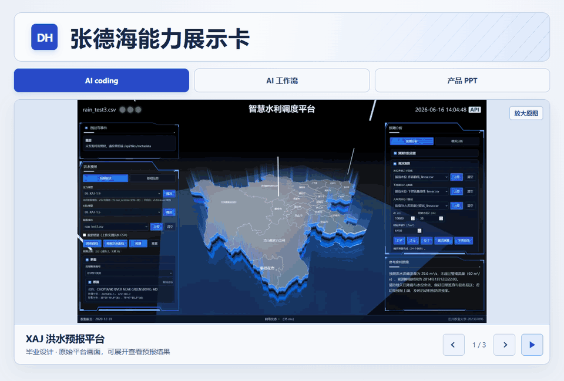

# 张德海能力展示卡

一个面向招聘浏览的静态作品集。页面依次展示 AI coding、AI 工作流和产品 PPT，支持桌面轮播、手机滑动和原图放大。首次打开时优先加载 XAJ 首图，高清原图在展开时读取。

[页面演示](#页面演示) · [快速预览](#快速预览) · [作品内容](#作品内容) · [发布](#发布) · [维护指南](Agent.md) · [一键启动与部署提示词](一键启动部署提示词.md)

## 页面演示

动图录自作品集的实际页面，依次展示 XAJ 首图、HydroLab 录屏、AI 工作流、产品 PPT 和原图放大。



## 快速预览

直接用浏览器打开仓库根目录的 [index.html](index.html)。页面使用 HTML、CSS 和原生 JavaScript，支持通过本地文件打开，也可以部署到静态托管。常规浏览无需安装依赖。

三个标签分别跳转到对应类别。静态图展示 2.5 秒，HydroLab 动图展示 4 秒，计时从画面就绪后开始。播完一类会接到下一类，最后回到起点。使用暂停按钮或放大原图可以完整观看录屏。系统启用减少动效时，首页默认暂停，轮播中的 HydroLab 使用静态封面，原图仍可打开。

## 作品内容

| 分类 | 展示内容 |
| --- | --- |
| AI coding | XAJ 洪水预报平台原界面与预报效果，HydroLab 水文计算助手运行录屏 |
| AI 工作流 | PKPM AI 协作建模迭代、BIMBase Skills 协作图谱、Dify 合同审查 |
| 产品 PPT | 产品技术框架、BIMBase 组件库、PKPM Agent、人机协作和参数化建模案例的五张原始幻灯片 |

HydroLab 录屏来自 [HydroPy-Computing](https://github.com/ZDH4869/HydroPy-Computing) 的演示素材，包含多种插值对照、泰森多边形面雨量和 RK4 调洪。轮播使用轻量 WebP，在「放大原图」中可以查看完整 GIF。XAJ 展项使用原始界面截图。工作流图在图内标注了生成插图、原始示例和评测数据的出处或口径。

## 发布

### GitHub Pages

1. 将仓库更新推送到 GitHub 的 `main` 分支。
2. 到仓库 **Settings → Pages**，把 **Source** 设为 **GitHub Actions**。
3. 在 **Actions → Publish portfolio to GitHub Pages** 选择 **Run workflow**，分支选 `main`。
4. 工作流成功后使用运行结果给出的 Pages 地址，在桌面和手机上打开一次。

[发布工作流](.github/workflows/pages.yml)调用静态导出脚本，只将页面、样式、脚本和所需图片打包进 Pages 工件。

### 其他静态托管平台

用 Node.js 22 在仓库根目录运行下面的命令。它更新同级的 `upload` 目录。

```text
node scripts/export-static.mjs
```

将 `upload` 内的内容作为网站根目录上传，保持 `assets/` 结构和文件名。也可以将现有父目录下的其他输出目录作为命令参数。导出遇到额外文件时会列出路径并停止，按需手动移走后继续。

## 工程结构

| 路径 | 作用 |
| --- | --- |
| `index.html` | 页面结构、首图和原图弹窗 |
| `portfolio.css` | 标题、配色、卡片和响应式排版 |
| `portfolio.js` | 分类顺序、轮播计时、下一张预取和原图查看 |
| `assets/` | 用于首屏与轮播的 WebP 资源 |
| `assets/original/` | 原图弹窗使用的 PNG 和 GIF |
| `scripts/export-static.mjs` | 从同一份文件清单导出静态托管目录 |
| `tests/portfolio_browser.py` | 可选的 Chromium 浏览器回归测试 |

## 验证

```text
node --check portfolio.js
node scripts/export-static.mjs
```

开发时可以在装有 Playwright 和 Chromium 的环境运行 `python tests/portfolio_browser.py`，验证跨类轮播、暂停、滑动、放大和窄屏标题。设置环境变量 `PORTFOLIO_ROOT` 为导出的目录可验证同一套发布文件。Python 仅用于开发阶段的浏览器回归。

页面代码采用 [MIT 许可证](LICENSE)。作品图与产品标识按各自权利归属。
